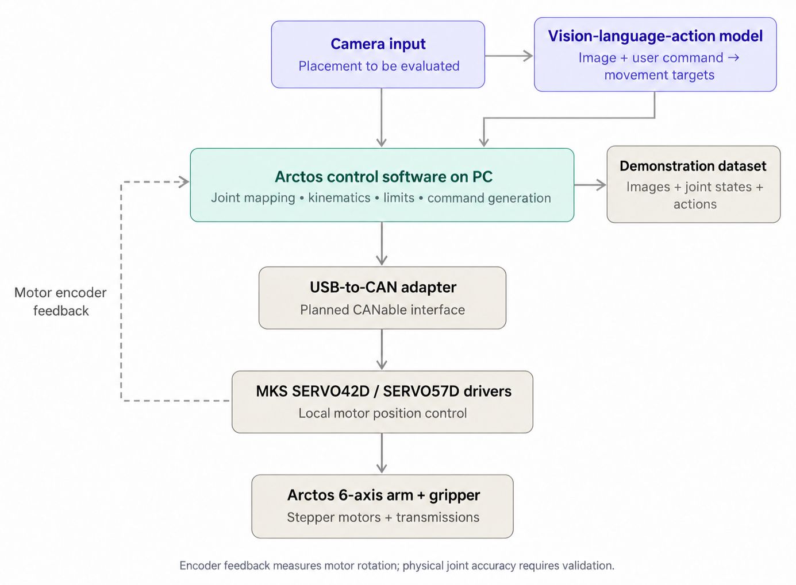

# Vision and language robotic arm

## Project overview

## Team roles

| Team member | GitHub | Responsibilities |
| --- | --- | --- |
| Samuel Phan | [@blayyd](https://github.com/blayyd) | Controls, electrical integration and computer vision |
| Dason Nathaniel | | Control testing, calibration and arm assembly |
| Qui Phu Pham | [@qpp112](https://github.com/qpp112) | Vision-language-action model implementation and finetuning |
| Ryan Ong | [@riannongg](https://github.com/riannongg) | End effector design, computer vision and arm assembly |

## Arm Control Software
- https://github.com/swimmingbrain/arctos-arm
- https://arctosrobotics.com/studio/
